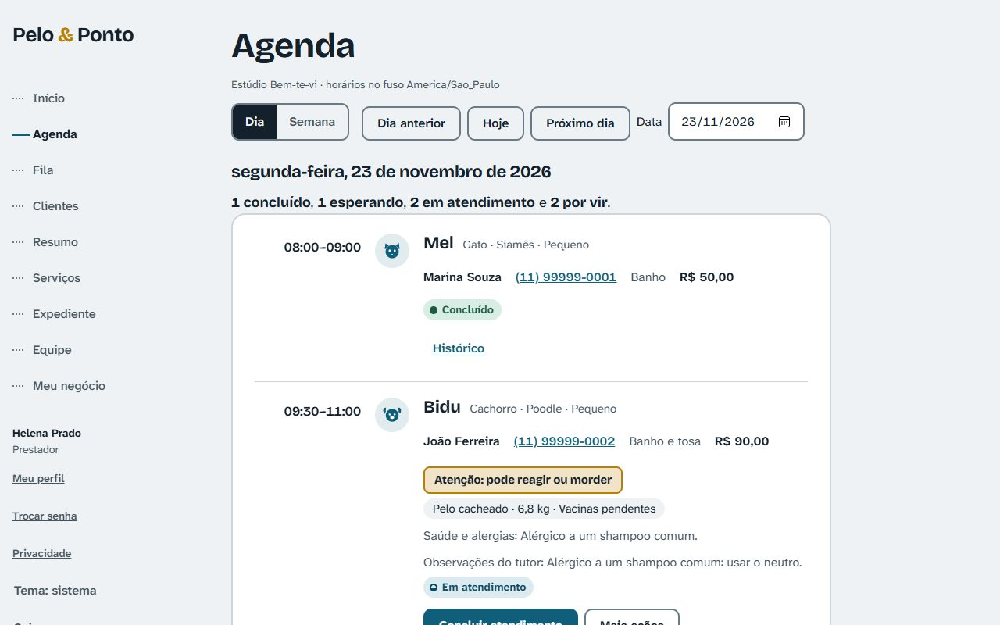
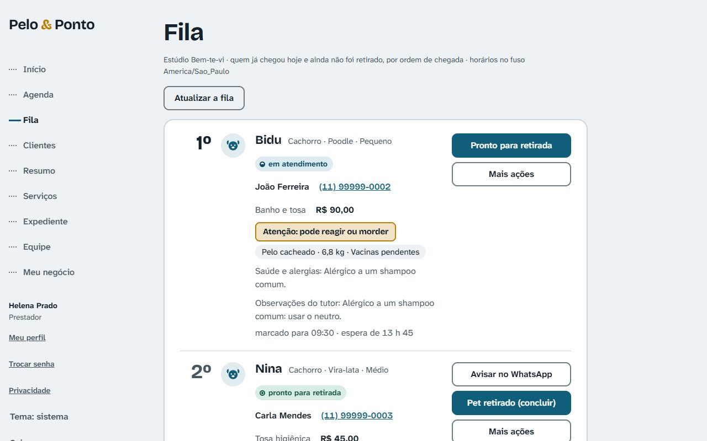
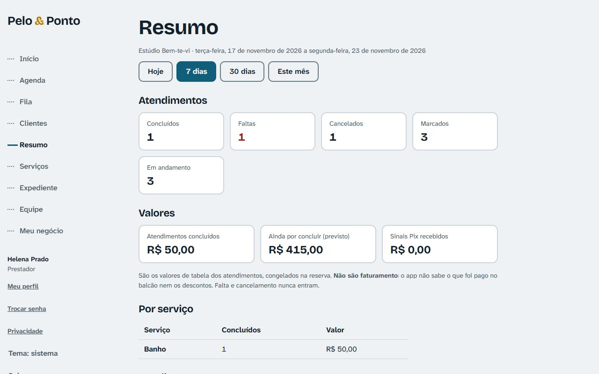
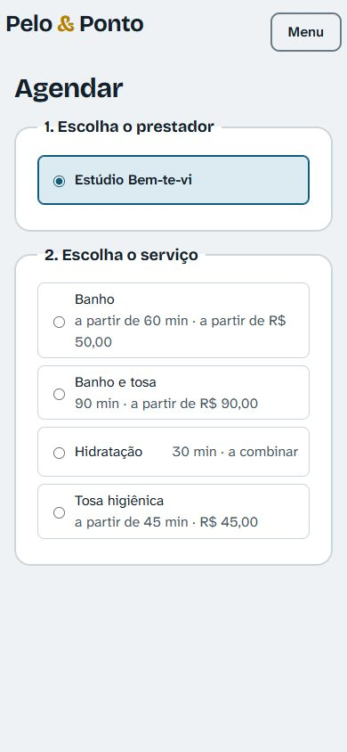

# Pelo & Ponto (QueueCare)

[](https://github.com/MatheusFranciscoLS/peloeponto/actions/workflows/ci.yml)

Scheduling and attendance queue for **pet grooming studios** (brand "Pelo & Ponto"). A Full Stack portfolio project: **Java 21 + Spring Boot**, **React + TypeScript**, **PostgreSQL**. Versão em português: [README.md](README.md).

It is built to the quality and feature level a real studio would use every day (agenda, queue, pet records, no-shows, waitlist, privacy, backups), but it is a portfolio project: there is no real studio behind it. "Pelo & Ponto" is the brand of the fictional studio; "QueueCare" is the project name, used in the documentation and the ADRs.

> **Try it in 30 seconds:** open [peloeponto.vercel.app](https://peloeponto.vercel.app), tap **"Conhecer sem cadastro"** (explore without signing up) and enter as the studio owner, an attendant or a customer. No sign-up and no password; all data is fictional.

## See it working

- **Live site:** [peloeponto.vercel.app](https://peloeponto.vercel.app). The API runs on Render's free plan and sleeps when idle, so the first visit after an idle period can take up to 2 minutes (the page says so, and the site starts waking it as soon as it opens). On the sign-in page, **"Conhecer sem cadastro"** (explore without signing up) opens a fictional studio in one click (owner, attendant or customer), with a sample agenda, queue and clients; you can also create a real customer account. The same sample studio runs on your machine with the command below.
- **Everything in one command, no Docker** (JDK 21 and Node 22+; the first run downloads dependencies):

  ```bash
  git clone https://github.com/MatheusFranciscoLS/peloeponto.git
  cd peloeponto/frontend
  npm ci
  npm run demo
  ```

  It starts the API with an embedded PostgreSQL and fictional data, plus the site at `http://127.0.0.1:5173`, and prints the accounts (owner, attendant, customer and admin; they share one password, shown in the terminal).

| Daily agenda (studio) | Attendance queue (studio) |
|---|---|
|  |  |

| Studio summary | Booking on a phone (customer) |
|---|---|
|  |  |

## Engineering decisions worth discussing

| Challenge | How it was solved |
|---|---|
| **Two people book the same slot at the same time** | The guarantee lives in the **database**: a PostgreSQL exclusion constraint over time ranges (`tstzrange` + `btree_gist`), which also prevents overlaps between services of different durations. Tested with simultaneous requests ([ADR 0002](docs/adr/0002-controle-de-concorrencia.md), PT). |
| **The booking response is lost and the user retries** | Repeating the same request returns the booking that already exists instead of a conflict with the user's own booking (matters when the free-tier API is waking up). Any difference is still a conflict ([ADR 0035](docs/adr/0035-reserva-idempotente.md), PT). |
| **Who may call what** | Authorization in the API, not the UI. A **role × route matrix generated from the OpenAPI contract** runs in CI: a new route without a declared rule **fails the build**. Another user's resource answers 404, identical to a missing one. |
| **Time zones and daylight saving** | Everything stored in UTC with the studio's IANA zone; nonexistent or ambiguous local times are rejected with a clear message. |
| **Privacy (LGPD)** | Customers download their own data and delete their account (anonymized in place, history kept); versioned privacy policy ([ADR 0027](docs/adr/0027-lgpd-minima.md), PT). |
| **Backups you know how to restore** | Encrypted backups with the **restore rehearsed on every PR** by CI, which has already caught real bugs ([ADR 0028](docs/adr/0028-backup-e-restauracao.md), PT). |
| **Accessibility measured, not assumed** | axe-core, visible focus, 44 px touch targets and no horizontal scroll, in light and dark, on every screen ([ADR 0018](docs/adr/0018-redesign.md), PT). |
| **Operating and diagnosing** | A request id on every response and log line, **one access line per call with route, status and duration and no personal data**, a deploy and rollback runbook, and automatic deploy after CI ([ADR 0029](docs/adr/0029-identificador-de-requisicao-e-operacao.md), [ADR 0036](docs/adr/0036-log-de-acesso.md), [operations](docs/operacao.md), PT). |
| **The pieces work together, not just each one** | Browser tests (Playwright) walk every role's flows with the real API and PostgreSQL **on every PR** (19 tests, about 2 minutes). The first time they ran in CI they found a test the public demo had broken unnoticed ([ADR 0042](docs/adr/0042-testes-de-navegador-no-ci.md)). |
| **A public demo that opens no hole** | Fictional accounts with **no usable password** (only the button signs in), a route that exists only when the demo is on, data that resets itself without a scheduler, and the operations that would touch the shared account blocked ([ADR 0041](docs/adr/0041-demonstracao-publica.md)). |

Every decision has an [ADR](docs/adr/) (in Portuguese) with what was **rejected** and the **known risks**, including the limits of running at zero cost ([ADR 0013](docs/adr/0013-hospedagem-custo-zero.md)).

## What it does

**Customers:** register pets (size, coat, weight, temperament, health, vaccines), book by service, pet, day and time (duration and price follow the pet's size and coat), see until when they can cancel for free, follow the attendance and join the waitlist when a day is full. **Studios:** daily and weekly agenda, attendance queue with states, pet record with a behavior warning, no-show tracking, counter registration and booking, time off and holidays, summary and clients. **Admins:** accounts. More detail in [`docs/features.en.md`](docs/features.en.md).

## Known limitations

Stated on purpose, each with its reason:

- **One appointment at a time per studio.** The booking guarantee in the database covers the whole studio, so a studio with two groomers cannot book two pets at the same time. Changing it touches the core of scheduling and was left as a conscious decision ([ADR 0043](docs/adr/0043-um-atendimento-por-vez-por-estudio.md)).
- **Free hosting.** The API sleeps when idle; startup takes about 50 seconds and the first call can take longer. The site says so and starts waking it as soon as it opens.
- **Reminders are manual.** The studio contacts the customer on WhatsApp with one click (a ready link); there is no automatic sending, which would need a paid service.
- **The public demo is shared.** Simultaneous visitors see each other's changes; data returns to the original on the first visit after 60 minutes ([ADR 0041](docs/adr/0041-demonstracao-publica.md)).

## Stack

- **Backend:** Java 21, Spring Boot 4, Spring Security (JWT), JPA, Flyway, PostgreSQL 16. [OpenAPI](docs/openapi.json) contract generated from the code and checked by a test.
- **Frontend:** React 19, TypeScript, Vite; Vitest and, in a real browser, Playwright (also in CI).
- **Delivery:** GitHub Actions (tests, browser tests, Docker image, backup restore, lint, secret scan), Vercel, Render and Neon, all on free plans.

## Run locally

Prerequisites: JDK 21, Node 22+, and Docker (or PostgreSQL 16) if you want a real database. The fastest path is `npm run demo` above.

```bash
# Backend: build and tests (they use an embedded PostgreSQL, nothing to install)
cd backend && ./mvnw verify

# Frontend: lint, tests and build
cd frontend && npm ci && npm run lint && npm test && npm run build
```

With a real database:

```bash
cp .env.example .env                       # change the values; never commit .env
docker compose --env-file .env -f infra/docker-compose.yml up -d

# terminal 1: load the variables from .env and run the API on http://localhost:8080
set -a; source .env; set +a
cd backend && ./mvnw spring-boot:run

# terminal 2: the frontend on http://localhost:5173 (proxies /api to :8080)
cd frontend && npm ci && npm run dev
```

The API needs `DB_URL`, `DB_USER`, `DB_PASSWORD` and `JWT_SECRET` (see `.env.example`; `JWT_SECRET` must be Base64 of at least 32 random bytes, e.g. `openssl rand -base64 32`). The first administrator is created once with an explicit command (see [ADR 0005](docs/adr/0005-provisionamento-de-contas.md)); no migration inserts users. Free deployment guide (no credit card): [`docs/publicacao.md`](docs/publicacao.md) (Portuguese).

## Documentation
[Architecture](docs/architecture.en.md) · [Features](docs/features.en.md) · [Business rules](docs/regras.md) (PT) · [ADRs](docs/adr/) (PT) · [Operations](docs/operacao.md) (PT) · [Study guides with interview questions](docs/estudo/) (PT) · [OpenAPI](docs/openapi.json).

## Authorship
Developed under the direction of the product owner (Matheus Francisco) with **substantial AI assistance**: Claude implements the technical work (including business rules and tests) and ChatGPT performs an independent review of every change before it is merged; Matheus defines the product, approves the direction and receives a summary of each delivery. This is not a demonstration of individual implementation. The process is in [`CLAUDE.md`](CLAUDE.md).

## License
[MIT](LICENSE).
