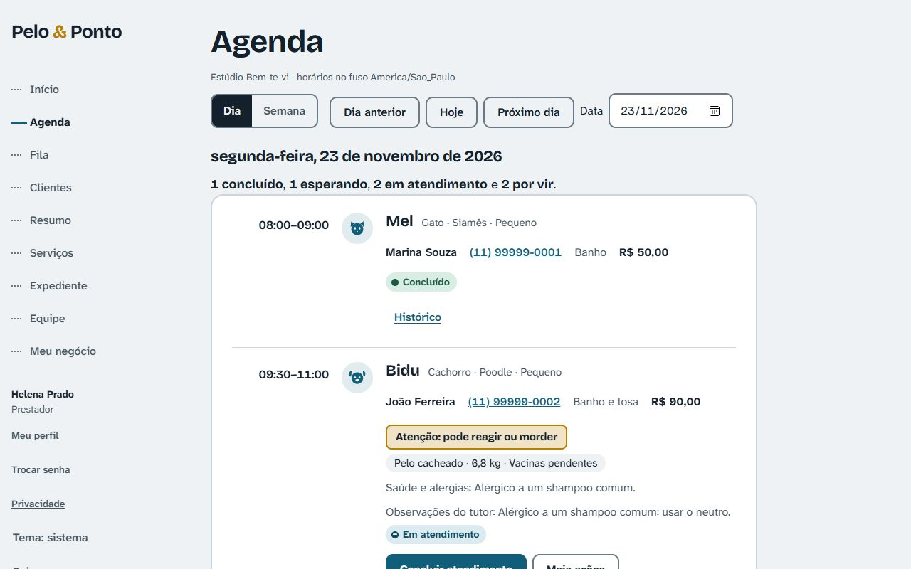
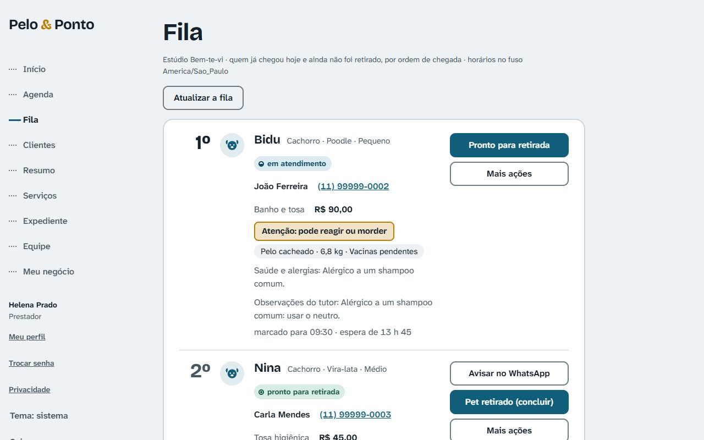
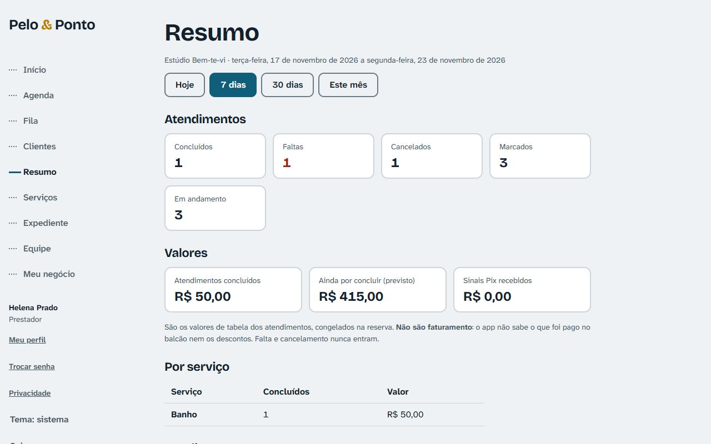
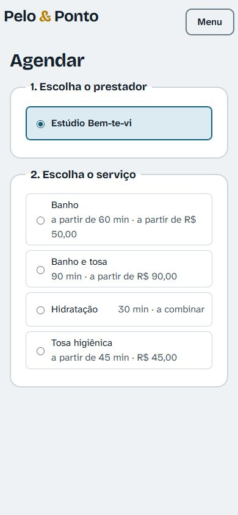
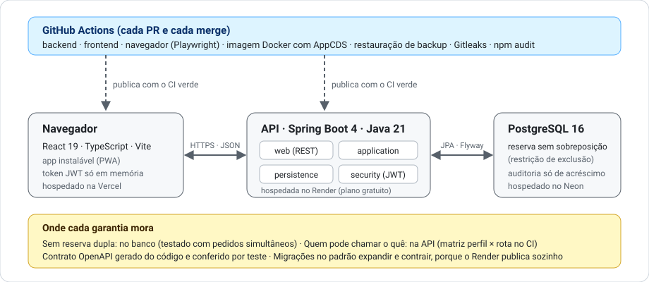

# Pelo & Ponto

### Agenda e fila de atendimento para estúdios de banho e tosa

O tutor agenda com o pet certo, o estúdio vê **quem chegou, quem está no banho e quem já pode ser retirado**, e **dois pedidos para o mesmo horário nunca viram duas reservas**, nem quando chegam ao mesmo tempo.

[Abrir a demonstração](https://peloeponto.vercel.app) · [Decisões de engenharia (ADRs)](docs/adr/) · [Falar com o autor](https://www.linkedin.com/in/matheusfranciscols)

## Visão do produto

O **Pelo & Ponto** responde a uma pergunta do dia a dia de um estúdio de banho e tosa: *quem vem hoje, em que estado está cada pet e o que a equipe precisa saber antes de começar*. O tutor cadastra os pets e agenda sozinho; o estúdio acompanha a agenda e a fila, registra faltas, atende o tutor que liga pelo balcão e mantém a ficha de cada pet (porte, pelo, comportamento, saúde).

Foi construído com a qualidade e as funções que um estúdio de verdade usaria, mas é um **projeto de portfólio: não há estúdio real por trás dele**. "Pelo & Ponto" é a marca do estúdio fictício; "QueueCare" é o nome do projeto, usado na documentação e nos ADRs.

> **Experimente em 30 segundos:** abra [peloeponto.vercel.app](https://peloeponto.vercel.app), toque em **"Conhecer sem cadastro"** e entre como dona do estúdio, atendente ou tutora. Não precisa de cadastro nem de senha, e todos os dados são fictícios. A API roda no plano gratuito do Render e dorme sem uso, então a primeira abertura pode levar até 2 minutos (a tela avisa).

## Telas

| | |
| :--- | :--- |
|  **Agenda do dia.** Cada atendimento com pet, serviço, horário e situação; a equipe registra chegada, conclusão e falta. |  **Fila de atendimento.** Quem já chegou e ainda não foi retirado, por ordem de chegada, com o aviso de comportamento do pet à vista. |
|  **Resumo do estúdio.** Atendimentos por situação e valores de tabela por período (a própria tela avisa que não é faturamento). |  **Agendar pelo celular.** O tutor escolhe serviço, pet, dia e horário; duração e valor seguem o porte e o pelo do pet. |

> Os prints são do estúdio de demonstração, com dados fictícios.

## Regras que o produto não quebra

| Regra | Como aparece no código |
| :--- | :--- |
| **Duas pessoas reservam o mesmo horário e só uma consegue**, nem ao mesmo tempo. | A garantia está no **banco**: restrição de exclusão do PostgreSQL sobre intervalos (`tstzrange` + `btree_gist`), que também impede sobreposição entre serviços de durações diferentes. Testado com requisições simultâneas ([ADR 0002](docs/adr/0002-controle-de-concorrencia.md)). |
| **Repetir um pedido não duplica a reserva.** | Se a resposta se perde e a pessoa tenta de novo, o mesmo pedido devolve a reserva que já existe, em vez de um conflito com a própria reserva. Qualquer diferença continua sendo conflito ([ADR 0035](docs/adr/0035-reserva-idempotente.md)). |
| **Quem pode chamar o quê é decidido na API, não na tela.** | Uma **matriz perfil × rota gerada do contrato OpenAPI** roda no CI: rota nova sem regra declarada **quebra o build**. Recurso de outro usuário responde 404, igual ao inexistente. |
| **O horário certo, inclusive no horário de verão.** | Tudo em UTC, com o fuso IANA do estúdio; horário que não existe ou é ambíguo é recusado com mensagem clara. |
| **O dado pessoal é do tutor.** | O tutor baixa os próprios dados e exclui a conta (anonimização no lugar, sem quebrar o histórico); o estúdio só alcança os tutores que ele mesmo cadastrou pelo balcão ([ADR 0027](docs/adr/0027-lgpd-minima.md), [ADR 0033](docs/adr/0033-cadastro-e-reserva-pelo-balcao.md)). |
| **Backup só vale se for restaurado.** | Backup criptografado e **restauração ensaiada em cada PR** pelo CI, que já pegou erros reais ([ADR 0028](docs/adr/0028-backup-e-restauracao.md)). |
| **Custo zero.** | Vercel, Render e Neon nos planos gratuitos, sem cartão. Os riscos de rodar assim estão escritos ([ADR 0013](docs/adr/0013-hospedagem-custo-zero.md)). |

## O que o sistema faz

### Tutor
- Cadastra os pets (porte, pelo, peso, comportamento, saúde, vacinas).
- Agenda escolhendo serviço, pet, dia e horário; **duração e valor seguem o porte e o pelo**, e a tela mostra até quando o cancelamento é grátis.
- Acompanha o atendimento, reagenda, e entra na **lista de espera** quando o dia está cheio.
- Baixa os próprios dados e exclui a conta.

### Estúdio (dono e atendentes)
- **Agenda do dia e da semana** e **fila** com os estados do atendimento (chegou, em atendimento, pronto, retirado).
- **Ficha do pet** com aviso de comportamento; registro de **faltas**, que liberam o horário; sinal por Pix.
- **Balcão:** cadastra o tutor que liga ou chama no WhatsApp, cadastra o pet e agenda por ele.
- Folgas e feriados (o tutor não agenda em dia fechado), clientes com senha temporária, resumo, equipe e lembrete pelo WhatsApp com a mensagem pronta.

### Administração
- Criação e manutenção das contas, com auditoria só de acréscimo.

O detalhe está em [`docs/funcionalidades.md`](docs/funcionalidades.md).

## Arquitetura

Monólito modular (web, application, persistence, security) com contrato OpenAPI gerado do código e conferido por teste. Detalhes em [`docs/arquitetura.md`](docs/arquitetura.md) e no [modelo de dados](docs/modelo-dados.md).

## Decisões de engenharia

As cinco que mais dizem sobre como o sistema foi pensado (cada uma com o que foi **descartado** e os **riscos conhecidos** no ADR):

- **Concorrência no banco, não na aplicação.** A aplicação valida, mas quem garante é o PostgreSQL; por isso a garantia vale mesmo com várias instâncias e pedidos simultâneos ([ADR 0002](docs/adr/0002-controle-de-concorrencia.md)).
- **Falha de rede não perde reserva.** Reserva idempotente, tela que mantém o horário escolhido quando a rede ou o servidor falham, e o site acorda a API enquanto a pessoa ainda lê a página ([ADR 0035](docs/adr/0035-reserva-idempotente.md), [ADR 0037](docs/adr/0037-acordar-a-api-ao-abrir-o-site.md)).
- **Autorização na API, não na tela.** Quem pode chamar o quê é validado no servidor; o prestador de quem opera vem sempre do banco, nunca da requisição, e uma **matriz perfil × rota gerada do contrato OpenAPI** roda no CI: rota nova sem regra declarada quebra o build ([ADR 0004](docs/adr/0004-vinculo-atendente-prestador.md), [ADR 0012](docs/adr/0012-contrato-openapi.md)).
- **Medir antes de otimizar.** A API gratuita dormia e a primeira chamada levava ~115 s. A medição mostrou que o custo era carregar classes numa CPU minúscula, e o **AppCDS** reduziu a partida de ~99 s para ~50 s, com o CI provando que o arquivo é usado ([ADR 0040](docs/adr/0040-partida-mais-rapida-com-appcds.md)).
- **Demonstração pública sem abrir brecha.** Contas fictícias **sem senha utilizável**, rota que só existe com a demonstração ligada, dados repostos sozinhos (sem agendador) e as operações que mexeriam na conta compartilhada bloqueadas ([ADR 0041](docs/adr/0041-demonstracao-publica.md)).

### Documentação complementar

Outras decisões e práticas, cada uma com seu ADR: operação e diagnóstico ([0029](docs/adr/0029-identificador-de-requisicao-e-operacao.md), [0036](docs/adr/0036-log-de-acesso.md), [operação](docs/operacao.md)); deploy automático com migrações no padrão expandir e contrair; segurança de conteúdo e dependências ([0038](docs/adr/0038-politica-de-seguranca-de-conteudo.md), [0039](docs/adr/0039-atualizacao-e-auditoria-de-dependencias.md)); acessibilidade medida ([0018](docs/adr/0018-redesign.md)); testes de navegador no CI ([0042](docs/adr/0042-testes-de-navegador-no-ci.md)); backup e restauração ([0028](docs/adr/0028-backup-e-restauracao.md)); LGPD mínima ([0027](docs/adr/0027-lgpd-minima.md)). A lista completa está em [docs/adr](docs/adr/).

## Nomes neste repositório

**Pelo & Ponto** é o nome do produto; **peloeponto** é o nome do repositório; **QueueCare**, `com.queuecare` e `queuecare-api` são nomes técnicos herdados do início do projeto e foram mantidos de propósito (renomear pacotes e serviços não traria valor e arriscaria quebrar o que funciona).

## Documentação

[Funcionalidades](docs/funcionalidades.md) · [Regras de negócio](docs/regras.md) · [Modelo de dados](docs/modelo-dados.md) · [Arquitetura](docs/arquitetura.md) · [ADRs](docs/adr/) · [Operação](docs/operacao.md) · [Backup](docs/backup.md) · [Privacidade](docs/privacidade-dados.md) · [Roadmap](docs/roadmap.md)

## Autoria e uso de IA

Projeto de portfólio de Matheus Francisco, desenvolvido sob a direção do dono do produto e **com assistência substancial de IA**: Claude implementa as partes técnicas (incluindo regras de negócio e testes) e o ChatGPT faz a revisão independente de cada mudança; o Matheus define o produto, aprova o rumo e recebe resumos de cada entrega. Não é uma demonstração de implementação individual. O processo está em [`CLAUDE.md`](CLAUDE.md) e o material de estudo em [`docs/estudo/`](docs/estudo/).

<strong>English overview</strong>

**Pelo & Ponto (QueueCare)** is a scheduling and attendance-queue system for pet grooming studios. Customers book with the right pet; the studio sees who arrived, who is being groomed and who is ready for pickup. Core rule: **two requests for the same time slot never become two bookings, even when they arrive together**: the guarantee lives in PostgreSQL (an exclusion constraint on time ranges), not only in the application.

Highlights: idempotent booking, authorization checked by a role × route matrix generated from the OpenAPI contract (a new route without a declared rule breaks the build), UTC with the studio's IANA time zone, LGPD-style data export and account anonymization, encrypted backups whose restore is rehearsed on every pull request, browser tests (Playwright) on every pull request, and a public demo with fictional, passwordless accounts that resets itself. Known limits are documented, such as one appointment at a time per studio.

The project holds 785 backend tests, 638 frontend tests, 19 browser tests, 79 operations in the authorization matrix, 29 migrations and 43 ADRs (counted on 2026-11-24). It runs at zero cost on Vercel, Render and Neon free plans.

[Open the demo](https://peloeponto.vercel.app) · [Full English README](README.en.md) · [Contact Matheus](https://www.linkedin.com/in/matheusfranciscols)

## Licença

[MIT](LICENSE).

---

Projetado e desenvolvido por [Matheus Francisco](https://github.com/MatheusFranciscoLS).

